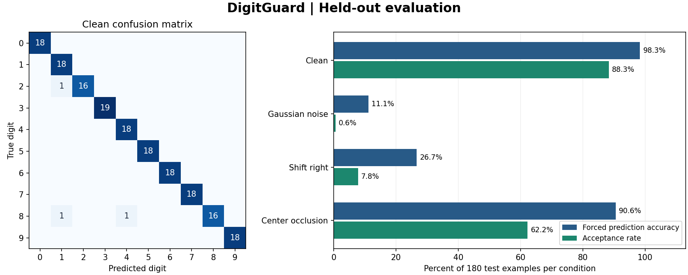

# DigitGuard

DigitGuard recognizes handwritten digits and can abstain when its decision rule rejects an input. This repository includes model selection, calibration, conformal prediction sets, stress testing, and a FastAPI service with an interactive drawing grid.



## Run locally

Use Python 3.12. From the repository root, create a virtual environment.

```bash
python -m venv .venv
```

Activate it with `source .venv/bin/activate` on Linux/macOS or `.venv\Scripts\Activate.ps1` in PowerShell, then run:

```bash
python -m pip install -r requirements.txt
python -m digitguard.train
python -m uvicorn digitguard.api:app
```

Open [the drawing lab](http://127.0.0.1:8000). Choose a labeled example and click **Load**, then **Predict**. Try erasing part of the digit to see how the output changes. [Swagger UI](http://127.0.0.1:8000/docs) documents the service.

Training recreates the model locally from the data bundled with scikit-learn. Model artifacts are excluded from version control. Set `DIGITGUARD_MODEL` to serve a custom artifact produced by this training code. Load joblib files from trusted sources only.

## Evaluation

The dataset contains 1,797 handwritten digits encoded as 8 × 8 grayscale images with pixel intensity 0–16. Scikit-learn's `load_digits` bundles a subset of the UCI Optical Recognition of Handwritten Digits data. This project creates its own stratified split of that bundled subset. [Dataset documentation](https://scikit-learn.org/1.8/modules/generated/sklearn.datasets.load_digits.html).

| Model | 5-fold CV macro F1 | Fold SD |
| --- | ---: | ---: |
| Logistic regression | 0.9609 | 0.0169 |
| Extra Trees | 0.9787 | 0.0119 |
| RBF SVM | **0.9814** | 0.0043 |

| Test condition | Top-1 accuracy | Accepted inputs | Accuracy among accepted |
| --- | ---: | ---: | ---: |
| Clean | 98.33% | 159/180 | 100.00% |
| Gaussian noise, SD 3 on the 0–16 scale | 11.11% | 1/180 | 100.00% |
| Shift one pixel right | 26.67% | 14/180 | 92.86% |
| Occlude center 2 × 2 pixels | 90.56% | 112/180 | 100.00% |

Top-1 accuracy forces a prediction on every row. The final column reports a separate metric on each row's accepted subset. Under Gaussian noise that subset contains only one input. The clean test macro F1 was **0.9831**. See [metrics.json](reports/metrics.json) for parameters, split counts, and the full confusion matrix.

## How it works

1. **Fit and select (1,078 rows).** Stratified five-fold grid search ranks candidates by macro F1. Feature scaling for linear and SVM models is fitted inside each fold.
2. **Scale probabilities (179 rows).** Fit a scalar temperature by minimizing negative log-likelihood. This transformation preserves class order.
3. **Construct prediction sets (180 rows).** Compute one minus the probability of the true label and use the finite-sample split conformal quantile at nominal 90% coverage.
4. **Select the abstention policy (180 rows).** Among singleton prediction sets, choose the lowest threshold that reaches at least 97% accuracy across at least 30 validation inputs. If no threshold qualifies, abstain on all inputs.
5. **Evaluate (180 rows).** Measure clean test performance and apply deterministic perturbations to the same images. Test labels are reserved for reporting.

The clean conformal set included the true digit in 160 of 180 inputs (88.89%). The nominal coverage target concerns marginal coverage under exchangeability. This experiment uses a stratified split, and the measured clean coverage is below the target. The stress cases change the input distribution and coverage fell further. Temperature scaling also increased held-out log loss from 0.1491 to 0.1752, so the displayed scores should be interpreted cautiously. The benchmark uses small, centered digit images and has no writer-level split. Hand-drawn browser inputs can differ substantially in style and centering.

## API

| Endpoint | Result |
| --- | --- |
| `GET /healthz` | Model readiness and selected model |
| `GET /v1/example?digit=3` | Held-out example and its label |
| `POST /v1/predict` | Decision, confidence, class probabilities, and conformal candidates |

Send `{"pixels": [...]}` with exactly 64 numeric values in row-major order, each between 0 and 16. A blank grid or rejected input returns a null prediction and an explicit reason. Class probabilities are ordered from digit 0 to digit 9 when available.

```bash
python - <<'PY'
import json
from urllib.request import Request, urlopen

base = "http://127.0.0.1:8000"
with urlopen(base + "/v1/example?digit=3") as response:
    example = json.load(response)
request = Request(
    base + "/v1/predict",
    data=json.dumps({"pixels": example["pixels"]}).encode(),
    headers={"Content-Type": "application/json"},
)
with urlopen(request) as response:
    print(json.dumps(json.load(response), indent=2))
PY
```

## Tests and Docker

```bash
python -m pip install -r requirements-dev.txt
python -m digitguard.train
python -m digitguard.report
python -m pytest -q
```

GitHub Actions retrains the model, generates the benchmark, runs tests, and publishes evaluation files as a workflow artifact.

```bash
docker build -t digitguard .
docker run --rm -p 8000:8000 digitguard
```

The Docker build trains the model. The service runs as an unprivileged user.

## Repository map

| Path | Contents |
| --- | --- |
| `digitguard/train.py` | Dataset splits, model search, training, and evaluation |
| `digitguard/core.py` | Probability scaling, conformal sets, abstention |
| `digitguard/api.py` | FastAPI app, input validation, and health check |
| `digitguard/web/` | Browser drawing lab |
| `digitguard/report.py` | Benchmark plot generation |
| `tests/` | Unit and real-model API integration tests |
| `reports/` | Measured results and benchmark chart |
